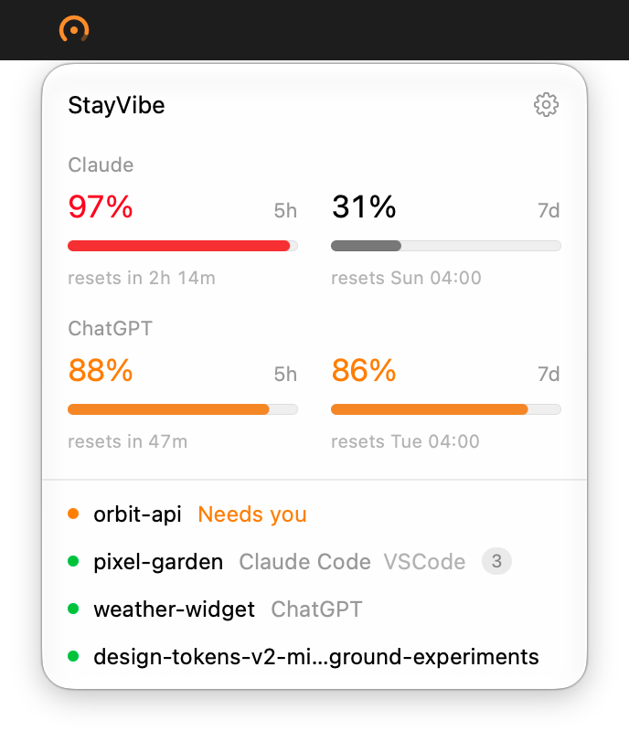
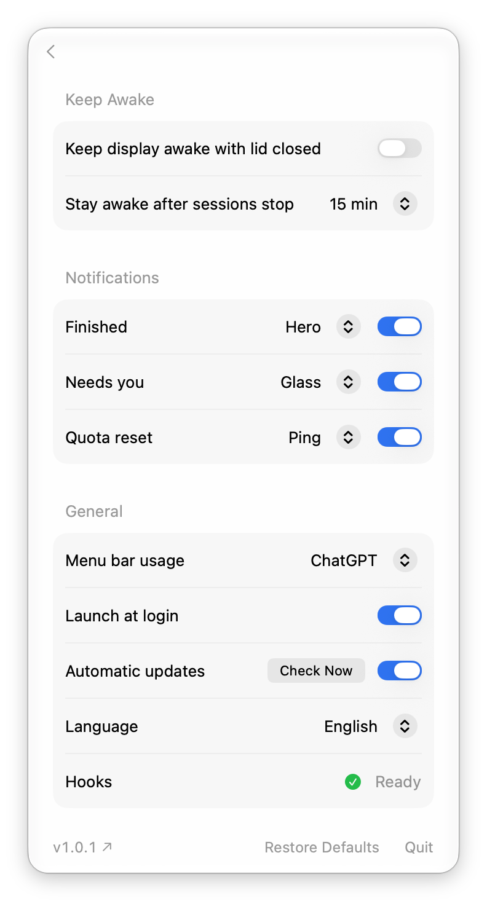

# StayVibe

[简体中文](README.zh-CN.md)

- Keeps your Mac awake while agents work and for a while after, even with the lid closed, so you can continue from your phone. Keeping the display awake with the lid closed is optional and off by default.
- Notifies you when a task finishes, needs you, or a limit resets.
- Shows both Claude and ChatGPT usage in the panel (paid plans). Choose the menu bar's source in Settings.
- Works in VS Code, the Claude and ChatGPT apps, and the terminal.




## Install and use

1. Download the DMG from [Releases](https://github.com/dvdsanyi/StayVibe/releases/latest) and drag StayVibe into Applications.
2. Open it. The first time, macOS blocks it because it isn't notarized: go to System Settings → Privacy & Security and click **Open Anyway**.
3. In ChatGPT, or the Codex panel in VS Code, click the hook icon next to the message box and choose **Trust all**.

## Build (for developers only)

```sh
git clone https://github.com/dvdsanyi/StayVibe.git
cd StayVibe
scripts/build.sh --install
scripts/screenshot.sh
```
