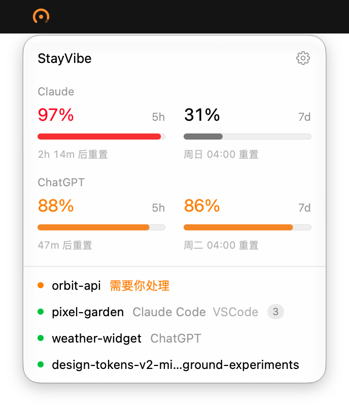
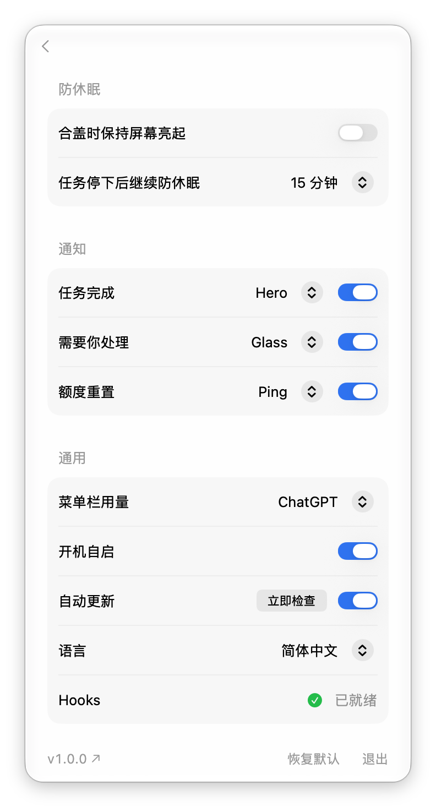

# StayVibe

[English](README.md)

- 任务进行时及停下后一段时间内，让 Mac 合盖也保持运行，方便用手机继续回复。可选合盖亮屏，默认关闭。
- 任务完成、需要你处理、额度重置时通知你。
- 面板同时显示 Claude 和 ChatGPT 的额度（付费套餐），可在设置中选择菜单栏显示的来源。
- 支持 VS Code、Claude、ChatGPT 和终端。




## 安装和使用

1. 从 [Releases](https://github.com/dvdsanyi/StayVibe/releases/latest) 下载 DMG，把 StayVibe 拖进「应用程序」。
2. 打开它。第一次会被 macOS 拦下，因为还没经过 Apple 公证：到「系统设置 → 隐私与安全性」点「仍要打开」。
3. 在 ChatGPT 或 VS Code 的 Codex 面板里，点输入框旁的钩子图标，选「Trust all」。

## 从源码构建（仅供开发者）

```sh
git clone https://github.com/dvdsanyi/StayVibe.git
cd StayVibe
scripts/build.sh --install
scripts/screenshot.sh
```
